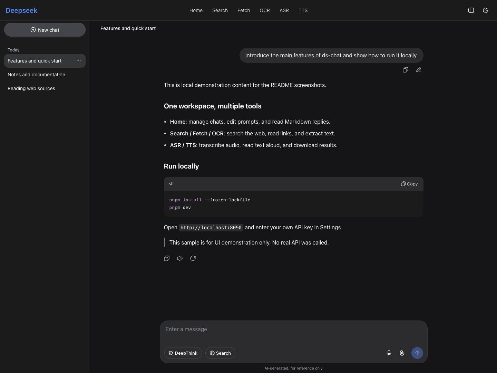
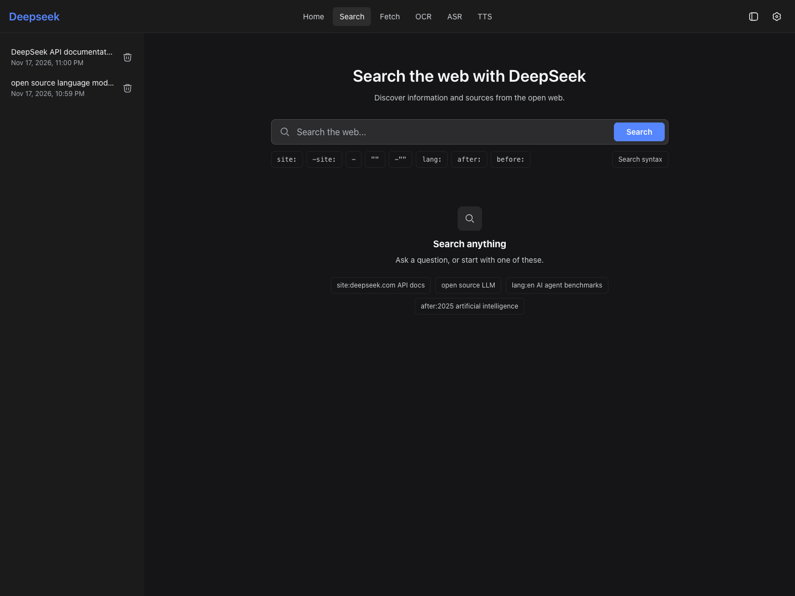
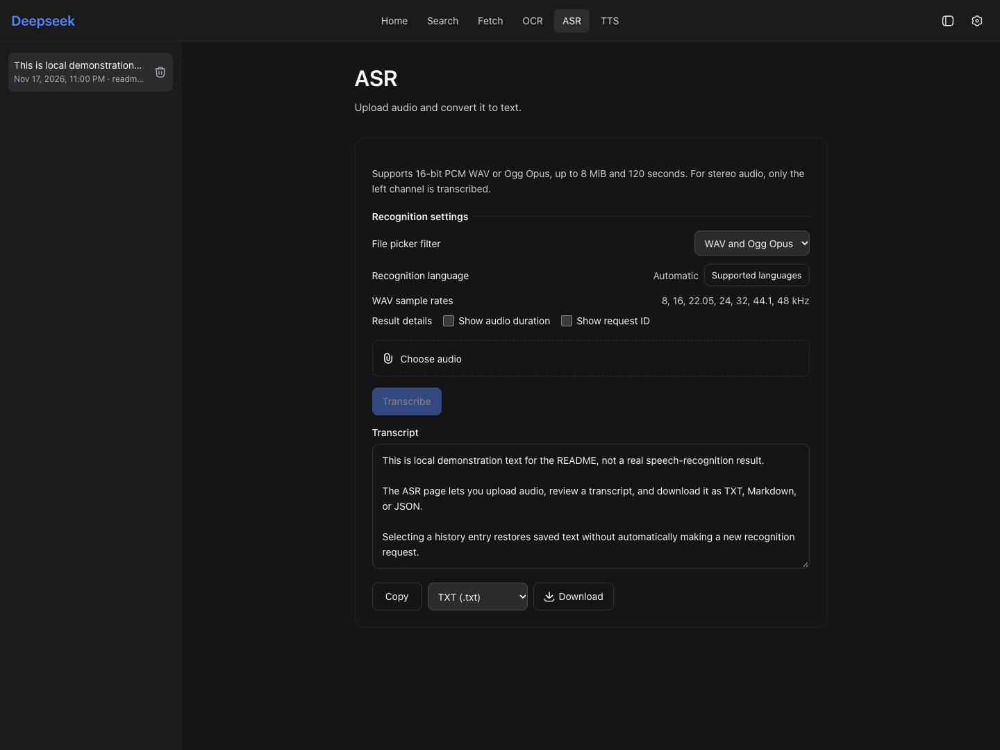
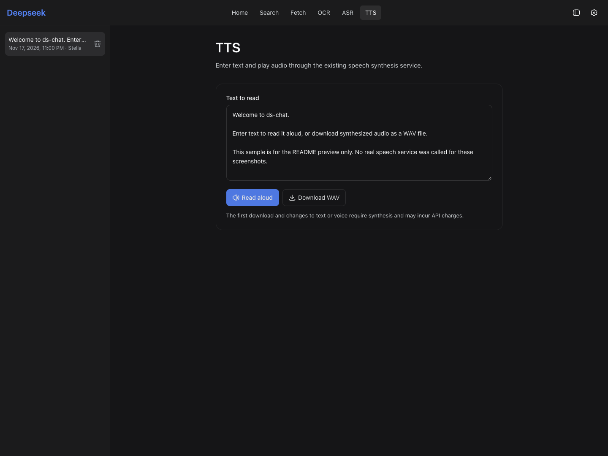
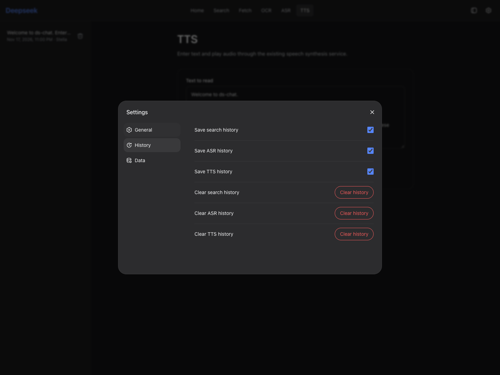
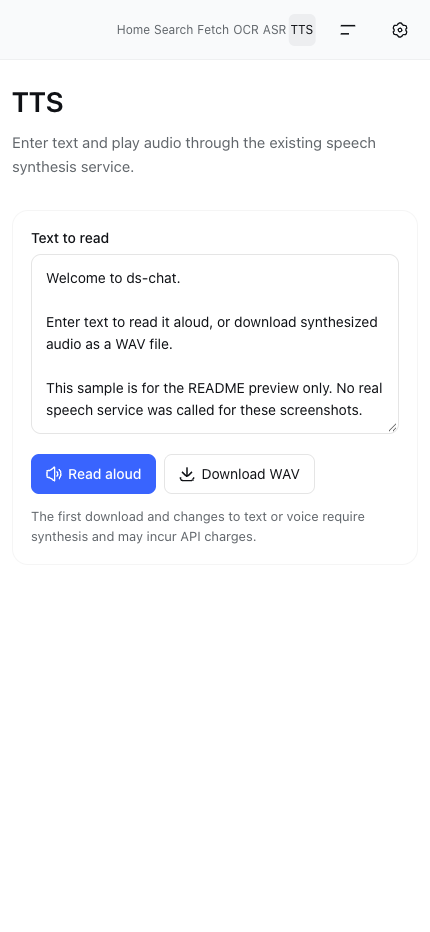

# ds-chat

English | [简体中文](README.zh-CN.md)

A static DeepSeek API client for chat, web search, link reading, OCR, speech recognition, and speech synthesis. No application backend is required: the browser connects directly to the configured API service.

## Screenshots

Captured from the current app with local demonstration data in an isolated browser profile. No real API requests, API keys, or personal conversations are shown. Desktop previews use the dark theme; the mobile preview uses the light theme.

### Chat workspace



<details>
<summary>Search, speech tools, and history settings</summary>

### Web search



### ASR transcript and export



### TTS playback and WAV download



### History settings



</details>

### Mobile layout



## Getting started

The CI workflow uses Node.js 24 and pnpm 12.6.0; the same versions are recommended for local development.

```sh
git clone https://github.com/yuchuangu85/ds-chat.git
cd ds-chat
pnpm install --frozen-lockfile
pnpm dev
```

Open http://localhost:8090 and enter your API key in Settings → Data before using API-backed features. Requests may incur charges from your API provider.

To build the static site:

```sh
pnpm build
```

The output is written to `dist/`. Deploy it to a static web server or open `dist/index.html` directly. Direct file access requires browser support for storage on `file://` pages and an API service that permits their cross-origin requests. Microphone input requires a secure context, such as HTTPS or localhost, and browser permission; a local development server is recommended.

The repository includes a [GitHub Pages workflow](.github/workflows/pages.yml). Enable Pages with GitHub Actions in the repository settings before deploying; a successful local build alone does not publish the site.

## Pages and features

- **Home** — Multiple conversations with automatic titles, renaming, and deletion. Stream replies, edit prompts, regenerate replies, switch message branches, stop generation, or continue eligible replies. Supports deep thinking, smart search, link reading, and source citations.
- **Search** (`#/search`) — Standalone web search with query operators, result summaries, and pagination.
- **Fetch** (`#/fetch`) — Submit a webpage URL to a new chat for link reading.
- **OCR** (`#/ocr`) — Upload a supported file and submit it to a new chat for text recognition. Fetch and OCR use separate tool drafts rather than overwriting the new-chat draft.
- **ASR** (`#/asr`) — Transcribe uploaded 16-bit PCM WAV or Ogg Opus audio, copy the result, or download it as TXT, Markdown, or JSON. Supports cancellation and optional duration/request-ID display. The page also lists the supported languages.
- **TTS** (`#/tts`) — Read text aloud or download synthesized WAV audio. The voice is selected in Settings → General; downloads can be cancelled.

Chat also supports attachment uploads, paste, drag and drop, voice input, and reading replies aloud. Rendering includes Markdown, syntax highlighting, KaTeX math, and Mermaid diagrams. The interface supports Simplified Chinese and English, light/dark/system themes, mobile layouts, location settings, and a collapsible history sidebar.

### Local history

Home shows chat history; Search, ASR, and TTS each show their own history. Fetch and OCR results remain in chat history.

- Search saves queries, not search results or fetched webpage content.
- ASR saves transcript text, the source filename, and duration when available; it does not save the original audio or request ID.
- TTS saves text and voice, not generated audio. Playback and downloads with identical text and voice reuse an existing record instead of adding another one. Existing duplicate records are not automatically merged.
- Selecting history restores the search input, ASR result, or TTS text and voice without automatically starting an API request.
- Settings → History controls recording and cleanup separately for Search, ASR, and TTS. Recording is enabled by default; turning it off does not delete existing records.
- Deleting a chat or tool-history entry requires confirmation. Cancel, Esc, or clicking the backdrop leaves the record intact. Bulk cleanup also requires confirmation.

### Speech limits and downloads

ASR accepts files up to **8 MiB** and **120 seconds**. Stereo audio uses the left channel. The page checks empty files and size locally; the API service validates encoding and duration. The file-picker filter does not convert audio. Language is detected automatically; requests do not include a language, sample-rate, or channel setting. ASR JSON downloads contain only transcript text, not request metadata or sentence timestamps.

TTS playback and the first WAV download use separate synthesis requests and may incur separate API charges. A completed download is cached in memory for repeat downloads while the page is open. Editing the text, changing the voice, or leaving the page clears that cache. WAV downloads have a **128 MiB** local limit. History deduplication does not cache audio across page visits or make new synthesis requests free.

## Data and privacy

API keys, general settings, and ASR display/filter preferences are stored in browser localStorage. Conversations, original chat attachments, and tool histories are stored in IndexedDB. Local data is isolated by browser profile and site origin; clearing browser site data can remove it.

Sending messages, uploading attachments, searching, and using speech features sends the relevant content and API credentials to the configured API service. There is no application backend holding your key. Use only a trusted deployment and API service; do not commit API keys to this repository.

Standalone Search uses `/v1/tools/search` directly. It does not use the separate server-side proxy, cache, or demo mode from the original `deepseek-search` project. The configured service must allow browser cross-origin requests.

### Backup, import, and deletion

Settings → Data provides ZIP import and export:

- **Export all history** includes conversations, Search/ASR/TTS history, their recording switches, and locally available original chat images. Other chat attachments retain metadata only. Unsent drafts, API keys, general/ASR preferences, original ASR audio, and generated TTS audio are excluded.
- **Import all history** requires confirmation and archive validation. It replaces local conversations and chat attachments; successful chat replacement also clears unsent drafts and returns to a new chat. If the archive includes `tool_history.json`, it also replaces tool histories and their recording switches; archives without that entry leave existing tool histories unchanged.
- **Delete all chats** clears local conversations, original chat attachments, and unsent drafts after confirmation. It stops ongoing replies and returns to a new chat, but preserves tool histories, API keys, and settings. Clear tool histories separately in Settings → History. Files already uploaded to the API service are not deleted.

Export a backup before importing, and save any unsent drafts separately. Chat and tool-history replacement use separate databases, not one atomic cross-database transaction; a tool-history import failure can occur after chats have been replaced. See the [archive format and preservation details (Chinese)](src/services/chat/history/README.md).

## Development

- `pnpm dev` — Start the development server on port 8090.
- `pnpm build` — Build the static site into `dist/`.
- `pnpm type` — Run TypeScript type checks.
- `pnpm lint` — Lint with oxlint.
- `pnpm test:asr` — Test ASR requests, settings, and transcript exports.
- `pnpm test:tts` — Test WAV downloads, validation, cancellation, and stream failures.
- `pnpm test:tool-history` — Test history persistence, deduplication, and sidebar deletion confirmation.
- `pnpm test:session-menu` — Test session-menu positioning and rename/delete actions.
- `pnpm test:chat-drafts` — Test isolated tool drafts and chat submission.
- `pnpm format` — Format with oxfmt; this writes files.

The tool-history and session-menu tests launch headless Chrome/Chromium. On macOS they use `/Applications/Google Chrome.app/Contents/MacOS/Google Chrome`; elsewhere they use `chromium` from PATH. Override the executable with `CHROME_BIN` if needed:

```sh
CHROME_BIN=/path/to/chromium pnpm test:session-menu
```

### API configuration

[rspack.config.ts](rspack.config.ts) uses `https://api.deepseek.com` by default. Its `createConfig({ apiOrigin, devServer })` helper configures the build-time API origin and optional development-server proxy. The origin is not a runtime Settings field; rebuild after changing it.

Chat uses `deepseek-flash` by default through Anthropic-compatible Messages / Files APIs. Requests include extensions for search, link reading, titles, and `latest_reminder`; standalone tools use `/v1/tools/search`, `/v1/tools/asr`, and `/v1/tools/tts`. A replacement service must support the capabilities you use, not only a generic chat-completions endpoint. Supported attachment formats are subject to client and server validation.

### Project layout

```text
src/
  app/                 Layout, navigation, routes, themes, and viewport handling
  components/          Chat, tools, history sidebars, settings, and shared UI
  i18n/                English and Chinese translations
  services/
    api/               API requests, SSE, and protocol types
    chat/              Conversations, message branches, storage, and ZIP backups
    markdown/          Markdown parsing, syntax highlighting, and diagrams
    speech/            Recording, read-aloud playback, and WAV downloads
    toolHistory.ts     Search, ASR, and TTS history storage
  utils/               Shared utilities
tests/                 API, storage, draft-isolation, and menu regression tests
```

## License

[MIT](LICENSE). The build copies the license to `dist/LICENSE`; include it when distributing the app. Third-party dependencies are subject to their own licenses.
