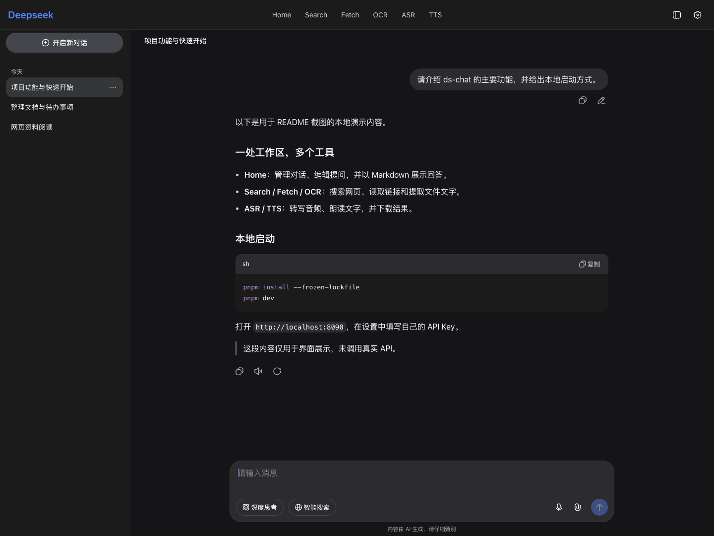
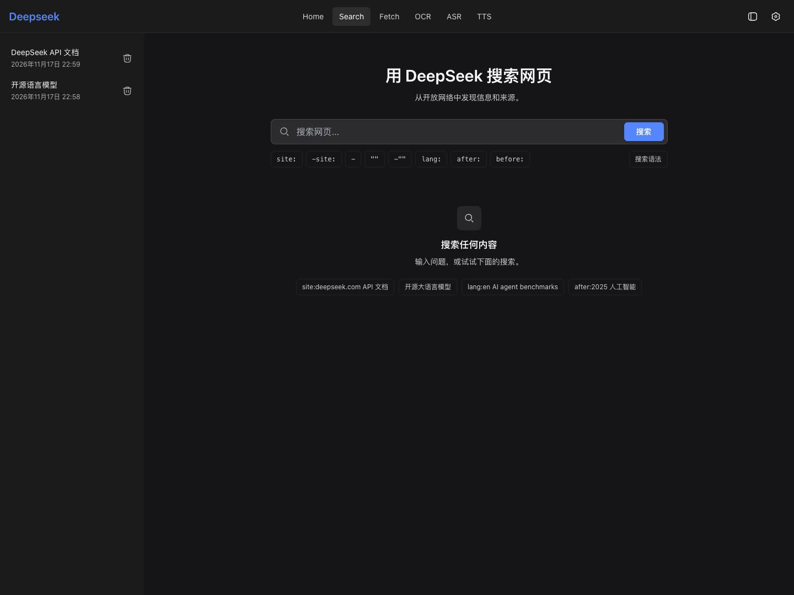
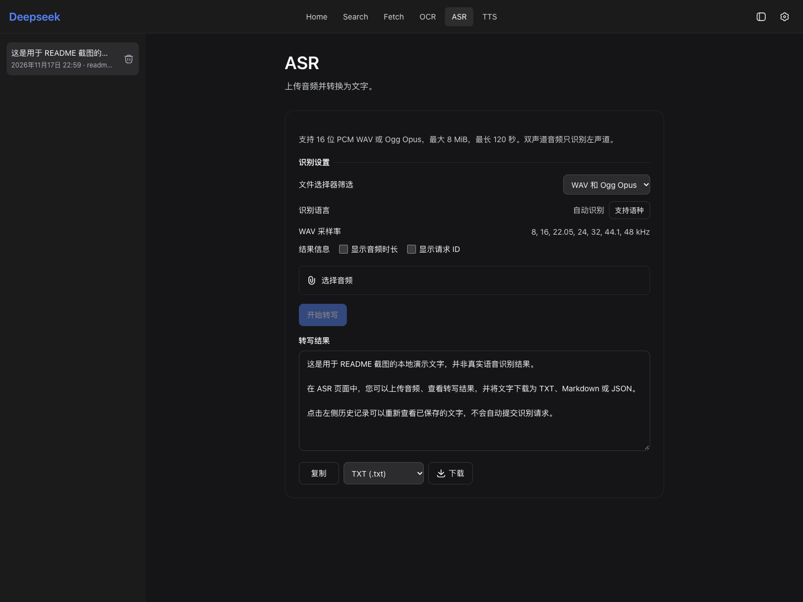
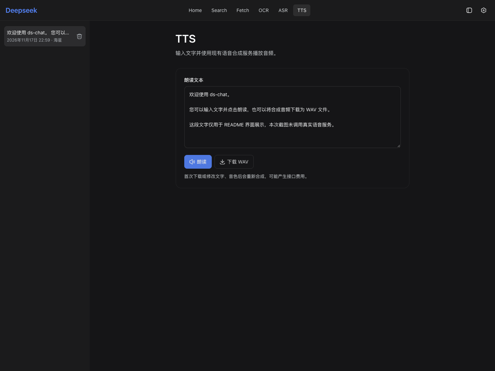
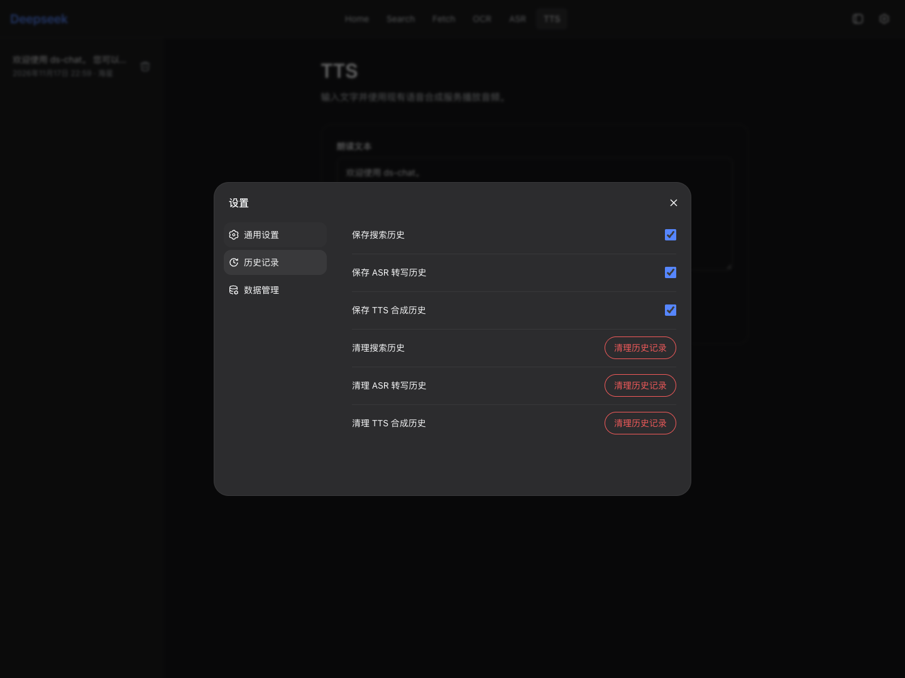
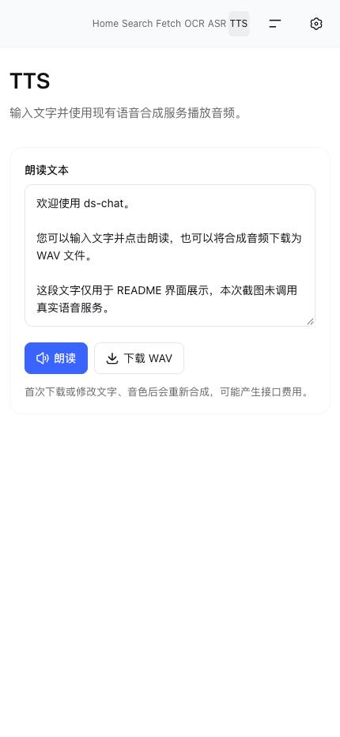

# ds-chat

[English](README.md) | 简体中文

基于 DeepSeek API 的静态聊天与工具客户端，集成对话、网页搜索、链接阅读、OCR、语音识别和语音合成。无需应用后端，浏览器直接请求配置的 API 服务。

## 界面截图

截图来自当前应用，使用独立浏览器配置及本地演示数据；未调用真实 API，不展示真实 API Key 或个人对话。桌面截图使用深色主题，移动端截图使用浅色主题。

### 聊天工作区



<details>
<summary>展开查看搜索、语音工具与历史设置</summary>

### 网页搜索



### ASR 转写与导出



### TTS 朗读与 WAV 下载



### 历史记录设置



</details>

### 移动端布局



## 快速开始

推荐使用与 CI 一致的 Node.js 24 和 pnpm 12.6.0：

```sh
git clone https://github.com/yuchuangu85/ds-chat.git
cd ds-chat
pnpm install --frozen-lockfile
pnpm dev
```

打开 http://localhost:8090 ，在「设置 → 数据管理」中填写 API Key 后使用接口功能。相关请求可能产生 API 服务费用。

生成静态产物：

```sh
pnpm build
```

产物位于 `dist/`，可部署到静态服务器，也可直接打开 `dist/index.html`。直接打开时，浏览器和 API 服务需允许 `file://` 页面的存储与跨域请求。麦克风输入需要 HTTPS、localhost 等安全上下文及浏览器授权，推荐通过本地开发服务器使用。

仓库提供 [GitHub Pages 工作流](.github/workflows/pages.yml)，部署前需在仓库设置中启用 GitHub Actions 作为 Pages 来源；本地构建成功不代表站点已发布。

## 页面与功能

- **Home**：多会话、自动标题、重命名与删除；流式回答、编辑提问、重新生成、切换消息分支、停止和符合条件的继续生成；支持深度思考、智能搜索、链接阅读与来源引用。
- **Search**（`#/search`）：独立网页搜索，支持搜索操作符、结果摘要和分页。
- **Fetch**（`#/fetch`）：提交网页 URL，在新对话中读取链接。
- **OCR**（`#/ocr`）：上传支持的文件，在新对话中提取文字。Fetch、OCR 使用各自独立的工具草稿，不覆盖新对话草稿。
- **ASR**（`#/asr`）：上传 16 位 PCM WAV 或 Ogg Opus 音频转写，支持复制、TXT / Markdown / JSON 下载、取消请求，以及可选的音频时长和请求 ID 显示；页面可查看支持语种。
- **TTS**（`#/tts`）：朗读文字或下载合成的 WAV 音频；音色在「设置 → 通用设置」中选择，下载过程支持取消。

聊天支持附件上传、粘贴与拖拽、语音输入和回复朗读；内容支持 Markdown、代码高亮、KaTeX 公式和 Mermaid 图表。界面支持简体中文与英文、浅色/深色/跟随系统主题、移动端布局、位置设置，以及可收起的历史侧边栏。

### 本地历史

Home 显示聊天历史，Search、ASR、TTS 分别显示自己的历史记录；Fetch、OCR 的结果仍由聊天历史承载。

- Search 保存搜索词，不保存搜索结果或抓取的网页内容。
- ASR 保存转写文字、原文件名和可用的音频时长，不保存原始音频或请求 ID。
- TTS 保存文字与音色，不保存生成的音频。同一文本和音色的朗读、下载复用已有记录，不重复新增；已经存在的重复记录不会自动合并。
- 点击历史只恢复搜索输入、ASR 结果或 TTS 文字与音色，不会自动发起 API 请求。
- 「设置 → 历史记录」可分别控制 Search、ASR、TTS 的记录开关和历史清理。默认开启记录，关闭开关不会删除已有记录。
- 删除对话或单条工具历史前会弹出确认；取消、Esc 或点击遮罩不会删除。批量清理也需要确认。

### 语音限制与下载

ASR 单个文件最大 **8 MiB**、最长 **120 秒**，双声道音频只识别左声道。页面检查空文件和大小，编码格式与时长由 API 服务校验；文件选择器筛选不会转换音频。语言自动识别，请求中不发送语言、采样率或声道设置。ASR 的 JSON 下载只包含转写文字，不包含请求元数据或逐句时间戳。

TTS 朗读和首次 WAV 下载各自发起合成请求，可能分别计费。下载完成的音频仅在当前页面内暂存于内存，供重复下载；修改文字、切换音色或离开页面后清除。WAV 本地下载上限为 **128 MiB**。历史去重不代表音频跨页面缓存，也不代表再次合成免费。

## 数据与隐私

API Key、通用设置和 ASR 筛选/显示偏好保存在浏览器 localStorage；会话、聊天附件原件及工具历史保存在 IndexedDB。本地数据按浏览器用户配置和站点源（origin）隔离，清除浏览器站点数据可能导致丢失。

发送消息、上传附件、搜索和使用语音功能时，相应内容及 API 凭据会提交给配置的 API 服务。项目没有代管密钥的应用后端，请只使用可信的部署页面和 API 服务，不要将 API Key 提交到仓库。

独立 Search 直接请求 `/v1/tools/search`，不依赖原 `deepseek-search` 项目的服务端代理、缓存或演示模式。配置的服务需允许浏览器跨域请求。

### 备份、导入与删除

「设置 → 数据管理」提供 ZIP 导入导出：

- **导出全部历史记录**：包含会话、Search / ASR / TTS 历史及各自的记录开关，以及本地可用的聊天图片原件；其他聊天附件仅保留元数据。不包含未发送草稿、API Key、通用/ASR 偏好、ASR 原始音频或 TTS 生成音频。
- **导入全部历史记录**：确认并通过归档校验后，替换本地会话和聊天附件；聊天替换成功后还会清空未发送草稿并回到新对话。归档包含 `tool_history.json` 时，同时替换工具历史和记录开关；不包含该条目的归档保留现有工具历史。
- **删除所有对话**：确认后清空本地会话、聊天附件原件和未发送草稿，停止正在生成的回复并回到新对话；保留工具历史、API Key 和设置。工具历史请在「设置 → 历史记录」中单独清理。已上传到 API 服务的文件不会删除。

导入前请先导出备份，并单独保存未发送草稿。聊天与工具历史分别写入不同数据库，不是跨库原子事务；工具历史导入失败时，聊天可能已经替换。格式与保留范围见[历史归档说明](src/services/chat/history/README.md)。

## 开发

- `pnpm dev`：启动开发服务器，默认端口 8090。
- `pnpm build`：构建静态产物到 `dist/`。
- `pnpm type`：TypeScript 类型检查。
- `pnpm lint`：oxlint 检查。
- `pnpm test:asr`：ASR 请求、设置及转写导出测试。
- `pnpm test:tts`：WAV 下载、格式校验、取消及流失败测试。
- `pnpm test:tool-history`：历史持久化、去重及侧边栏删除确认测试。
- `pnpm test:session-menu`：会话菜单定位及重命名/删除操作回归测试。
- `pnpm test:chat-drafts`：工具草稿隔离与聊天提交测试。
- `pnpm format`：使用 oxfmt 格式化，会修改文件。

工具历史和会话菜单测试需要启动无头 Chrome / Chromium。macOS 默认使用 `/Applications/Google Chrome.app/Contents/MacOS/Google Chrome`，其他平台默认使用 PATH 中的 `chromium`；可通过 `CHROME_BIN` 指定路径：

```sh
CHROME_BIN=/path/to/chromium pnpm test:session-menu
```

### API 配置

[rspack.config.ts](rspack.config.ts) 默认连接 `https://api.deepseek.com`。通过其中的 `createConfig({ apiOrigin, devServer })` 配置构建期 API 地址及可选的开发服务器代理；地址不是运行时设置项，修改后需要重新构建。

聊天默认使用 `deepseek-flash`，通过 Anthropic 兼容的 Messages / Files API 通信。请求包含搜索、链接阅读、标题和 `latest_reminder` 等扩展；独立工具使用 `/v1/tools/search`、`/v1/tools/asr`、`/v1/tools/tts`。替换服务需支持实际使用的相应能力，而不只是通用聊天补全接口。附件格式受客户端和服务端校验约束。

### 项目结构

```text
src/
  app/                 布局、导航、路由、主题与视口处理
  components/          聊天、工具、历史侧边栏、设置与通用组件
  i18n/                中英文文案
  services/
    api/               API 请求、SSE 与协议类型
    chat/              会话、消息分支、本地存储与 ZIP 备份
    markdown/          Markdown 解析、代码高亮与图表
    speech/            录音、朗读与 WAV 下载
    toolHistory.ts     Search、ASR、TTS 历史存储
  utils/               通用工具
tests/                 API、存储、草稿隔离与菜单回归测试
```

## 许可证

[MIT](LICENSE)。构建会将许可证复制到 `dist/LICENSE`，分发时请一并保留；第三方依赖遵循各自的许可证。
